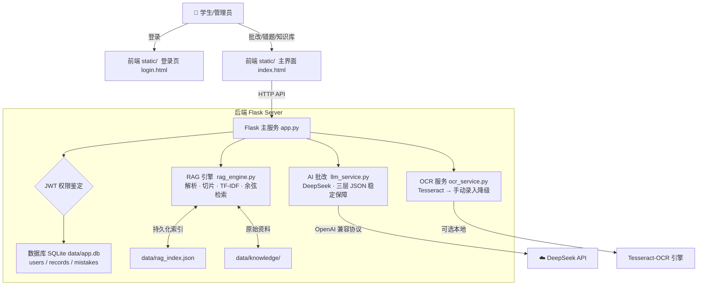

# AI 智能作业批改 Web 平台

> 软件工程课程实验项目 · V1.0 MVP

基于 **Flask + SQLite + TF-IDF 自研 RAG + DeepSeek 大模型** 的中小学作业自动批改与错题管理平台，支持：作业图片上传 → OCR 识别（可手动修正）→ RAG 知识点检索 → AI 智能逐题批改 → 错题自动入库 → 多用户数据隔离。

---

## ✨ 功能亮点

| 功能模块 | 能力说明 | 对应 Epic |
|---------|---------|-----------|
| 🔐 用户体系 | 注册 / 登录（JWT 鉴权），管理员 + 学生双角色，**越权访问拦截**（每道错题/记录强制按 user_id 过滤） | Epic-07 |
| 📷 作业上传 | 拖拽 / 点击上传图片（jpg/png/webp/bmp，≤10MB），前端即时预览缩略图 | Epic-01 |
| 🔍 OCR 识别 | 本地 Tesseract OCR，识别失败自动降级为**手动录入文本**（保证主链路 100% 可用） | Epic-02 |
| 📚 RAG 知识库（纯 Python 离线实现） | 自研 TF-IDF + 自定义中英文混合分词；支持 txt / md / pdf / docx；短段合并 + 长段滑窗切片；TopK 召回 + 低分阈值过滤 | Epic-03 |
| 🤖 AI 智能批改 | DeepSeek V3 OpenAI 兼容接口，**三层 JSON 稳定保障**（JSON 模式优先 → 端点降级重试 → 非 JSON 二次补请求），返回总分、总评、逐题（对错/得分/参考答案/错误原因/知识点/解析） | Epic-04 |
| 📒 错题本 | 错题自动落库（is_correct=False 自动收录）；按学科/掌握状态/关键词筛选；标记已掌握 / 删除 / 原图预览 | Epic-05 |
| 🛠 管理员后台 | 知识库上传 / 文件夹扫描入库 / 资料删除 / RAG 召回测试 / DeepSeek 配置与 RAG 参数动态调整 | Epic-03 Admin |
| ✅ 自动化测试 | pytest 三层测试金字塔：**Unit 29 / Integration 27 / E2E 4 = 60 条全通过 0 失败** | Epic-06 |

---

## 🏗 系统架构图



---

## 📁 项目结构（清晰的单职责分层）

```
ai-homework-check/
├── app.py                      # Flask 主服务（按 Epic 分区写路由：认证 / 批改 / 错题 / 知识库 / 设置）
├── config.py                   # 统一配置入口：路径 + JWT + LLM + RAG 参数；Key 三级优先级（环境变量 > settings.json > api_key.txt）
├── ocr_service.py              # OCR 适配层：Tesseract + 缺失自动降级
├── rag_engine.py               # RAG 引擎（纯 Python，无向量库依赖）：解析/切片/向量化/检索
├── llm_service.py              # AI 批改服务：Prompt 模板 / 调用 / 重试 / JSON 解析
│
├── run.py                      # ⭐ 一键启动脚本（Python 版本 / 依赖 / 目录 / Key / 端口 自动检查 + 依赖自动安装）
├── run_tests.py                # ⭐ 一键测试脚本（unit / integration / e2e / with-llm 多种模式切换）
├── pytest.ini                  # pytest 全局配置 + Marker 注册
├── requirements.txt            # 运行依赖
├── .gitignore                  # 忽略：app.db / settings.json / uploads / __pycache__ 等
│
├── static/                     # 前端（纯 HTML + 原生 JS，无构建步骤）
│   ├── login.html / login.js   # 登录 + 注册页（Epic-07）
│   ├── index.html / app.js     # 主界面 3 Tab：作业批改 / 错题本 / 知识库管理
│   └── css/style.css           # 全局样式（模块分区）
│
├── tests/                      # 自动化测试 60 条全通过
│   ├── conftest.py             # 公共 fixtures：沙箱 DB / 4 个用户 token / 独立 RAG 实例（互不污染）
│   ├── unit/test_unit_core.py              # Unit：OCR清洗 + RAG切片/分词/TF-IDF + LLM纯逻辑（29 条）
│   ├── integration/test_api_integration.py # Integration：认证 11 条 + 批改参数 + 错题 CRUD + 知识库（27 条）
│   └── e2e/test_e2e_pipeline.py            # E2E：主链路批改→错题落库 + 数据隔离 + 设置生效（4 条 + 1 条真实 LLM）
│
└── data/                       # 运行时数据（与代码严格分离）
    ├── app.db                  # SQLite 数据库（首次启动自动建表 + 默认账号）
    ├── rag_index.json          # RAG 向量化索引持久化
    ├── settings.json           # 管理员配置（API Key / RAG 参数）
    ├── uploads/                # 用户上传作业图片
    └── knowledge/              # 知识库原始文件（txt / md / pdf / docx）
```

---

## 👥 小组分工（4 人 · 边界清晰）

| 成员 | 角色 | **负责交付内容** | 对应代码/文档 |
|------|------|-----------------|-------------|
| 🏅 **刘广**（组长） | 后端 + 总协调 + 测试统筹 | ① Flask 主服务 & 数据库表设计 & 初始化 ② JWT 登录鉴权 & 权限装饰器 ③ 启动脚本 run.py ④ 跨模块联调 & 最终验收 | [app.py](app.py) · [config.py](config.py) · [run.py](run.py) |
| **周浩** | 需求 + 后端服务层 | ① OCR 服务适配 & 降级策略 ② AI 批改服务封装 ③ 异常处理 & 错误码统一 ④ 需求文档规范对接 | [ocr_service.py](ocr_service.py) · [llm_service.py](llm_service.py) |
| **粱祺** | 前端负责人 + Jira 任务拆解 | ① 登录页 UI & 鉴权前端拦截 ② 主界面（批改 / 错题 / 知识库）3 个 Tab + 全部交互逻辑 ③ 全局样式 & 响应式 ④ Jira 任务编号与代码行一一映射 | [static/](static/) |
| **王晨宇** | 文档整合 + RAG 后端 + 测试方案 | ① 自研 TF-IDF RAG 引擎（切片/分词/向量化/检索） ② 知识库管理员接口 ③ 两次实验报告 & 本 README 整合输出 ④ 60 条自动化测试用例设计与实现 | [rag_engine.py](rag_engine.py) · [tests/](tests/) · [run_tests.py](run_tests.py) |

---

## 🚀 快速启动（3 步跑起来）

### 环境要求：
- **Python ≥ 3.8**（推荐 3.11 / 3.13）
- Windows / macOS / Linux 均可

### Step 1：克隆并进入项目

```bash
cd ai-homework-check
```

### Step 2：⭐ 直接用一键启动脚本（自动检查 & 装依赖 & 初始化）

```bash
python run.py
```

> 💡 **脚本会自动帮你做 6 件事**：检查 Python 版本 → 安装缺失依赖（Flask / requests / PyJWT / pypdf 等）→ 创建 data/uploads 等目录 → 检查 DeepSeek API Key（没配也能启动，后续在后台补）→ 检查 5000 端口占用 → 初始化数据库 + 默认账号。
>
> 想换端口？`set AI_HOMEWORK_PORT=5001 && python run.py`（Windows）

### Step 3：浏览器访问 + 登录

访问：**http://localhost:5000/**

| 账号 | 密码 | 角色 | 能做什么 |
|-----|-----|-----|---------|
| `admin` | `admin123` | 管理员 | 批改作业 + 错题本 + 【知识库管理 Tab】+【模型设置】 |
| `student` | `123456` | 学生 | 批改作业 + 自己的错题本（看不到后台 Tab） |
| 自行注册 | ≥6 位密码 | 学生 | 走 `/api/auth/register` 或登录页注册 Tab |

### Step 4（推荐）：给管理员账号先入库一份示例教材

1. admin 登录 → 右上角【知识库管理】Tab
2. 点【📂 扫描 data/knowledge 文件夹并入库】
3. 看到「小学数学知识点示例.txt → 入库成功」提示 ✅ 后，RAG 检索就生效啦～

> （可选）去【模型设置】填你自己的 DeepSeek API Key，保存后立即生效，不用重启服务。

---

## ✅ 跑自动化测试（60 条全绿）

### 方式 1：⭐ 一键脚本（推荐，无真实 LLM 调用 / 不花钱）

```bash
python run_tests.py
```

默认跑：Unit 29 + Integration 27 + E2E 4 = **60 条用例**，60 passed, 0 failed。

### 方式 2：按需切换模式

```bash
# 只跑单元测试（10 秒内跑完）
python run_tests.py --unit

# 只跑端到端主链路（alice+bob 批改→错题落库→数据隔离）
python run_tests.py --e2e

# 集成测试 + 端到端
python run_tests.py --integration --e2e

# ⚠️ 连真实 DeepSeek API 一起跑（需要配好 Key，会消耗额度）
python run_tests.py --with-llm --slow

# 生成覆盖率报告（需要 pip install pytest-cov，会产出 htmlcov/index.html）
python run_tests.py --all
```

### 方式 3：直接用 pytest 原生命令

```bash
pip install pytest pytest-cov
pytest tests -v --tb=short -m "not require_llm and not require_ocr and not slow"
```

---

## 🧪 测试覆盖范围（对应 Jira 需求编号）

| 层级 | 用例数 | 覆盖的 Jira 测试方案编号 |
|------|-------|------------------------|
| Unit | 29 | OCR-01/03、RAG-01~05/07/09/11/12、AI-05/06/07/09 |
| Integration | 27 | AUTH-01~11、批改参数校验、错题 CRUD（E2E-03/04/05）、知识库 RAG-08/09/10 |
| E2E（Mock LLM） | 4 | ⭐ **E2E-01 主链路：批改→错题自动落库** ×2 / E2E-02 数据隔离 / E2E-07 设置生效 |
| E2E（真实 LLM） | 1 | 真实 DeepSeek API 回归 2 道错题（需 `--with-llm --slow`） |

---

## 📝 常见问题 FAQ

### Q1：我没装 Tesseract-OCR，会影响 AI 批改吗？
**不影响。** 项目设计了**优雅降级**（[ocr_service.py](ocr_service.py)）：没装 pytesseract 或 Tesseract 引擎时，OCR 返回空文本，前端文本框会亮起并显示提示"请手动录入或修改识别内容"。学生手动输入题目后照样能提交批改，主链路 100% 可用。

### Q2：DeepSeek Key 没配会怎么样？
**批改接口会返回友好错误 + 不抛异常堆栈**（[llm_service.py](llm_service.py)），前端弹 Toast 提示"请联系管理员配置 DeepSeek API Key"。其它功能（注册登录、错题本增删改查、知识库上传与检索测试）照常使用。

### Q3：怎么快速重置数据库？
直接删掉 `data/app.db`，下一次 `python run.py` 启动时会自动重建 + 重新插入默认的 admin/student 账号。

### Q4：Windows PowerShell 运行 `& 'E:\...\python.exe' run_tests.py` 显示 UnexpectedToken？
把解释器加到 PATH 环境变量最前面，之后直接写 `python run_tests.py` 就行；或者把命令写在 `.bat` / `.ps1` 脚本里再执行。

### Q5：跑 pytest 时出现「werkzeug has no attribute __version__」？
本项目 `tests/conftest.py` 顶部**已经内置了 Werkzeug 3.x 自动兼容补丁**，正常启动后不会出现；如果你是在自己的另一个虚拟环境里跑，装回 Werkzeug 2.x 也可以。

---

## 🗓 版本与迭代计划

| 版本 | 内容 | 状态 |
|------|------|------|
| **V1.0 MVP** | Epic-01/02/03/04/05 核心 + Epic-07 登录鉴权 + 60 条自动化测试 | ✅ 已交付 |
| V1.1 | Epic-08 爬虫知识库 + 错题本 PDF 导出 + 云端 OCR（百度/阿里） | 🔜 计划中 |

---

> 🔒 安全提示：`.gitignore` 已忽略 `data/app.db` / `data/settings.json` / `data/uploads/` / `api_key.txt`，请**不要**把真实 API Key 或学生作业图片提交到公开仓库。
